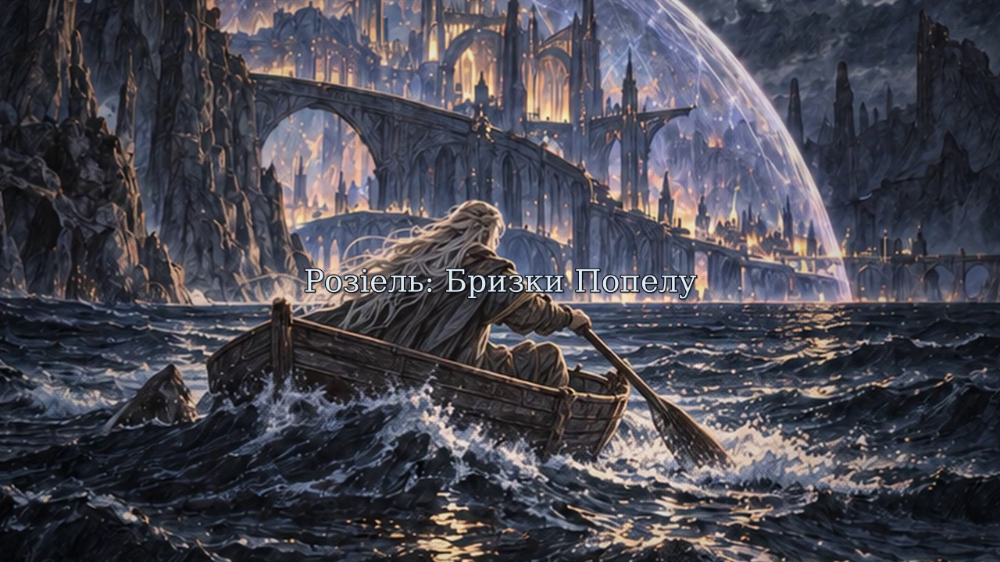

# movie

## Розіель: Бризки Попелу

Повна українська відеоверсія — **25:00**, включно з титрами.
Мальований motion-comic у стилі обкладинки наданої книги: ілюстровані сцени,
рух камери, світло й попіл, синтетичні українські голоси, музика та вмонтовані субтитри.



### Завантажити фільм

| Версія | Розмір | Посилання |
| --- | ---: | --- |
| Оригінал: 720p, 24 кадри/с, стереозвук | 229 МБ | [Завантажити MP4](https://github.com/F3elenkS/movie/raw/refs/heads/main/film/Roziel_Bryzky_Popelu_25min_UA.mp4) |
| Легка копія: 480p, 12 кадрів/с, монозвук | 31 МБ | [Завантажити MP4](https://github.com/F3elenkS/movie/raw/refs/heads/main/film/Roziel_25min_480p.mp4) |

Обидва файли містять усі 25 хвилин фільму. Легка копія має нижчу якість зображення й звуку.
Збережіть MP4 на комп’ютер і відкрийте у VLC, програвачі Windows або іншому відеопрогравачі.

Субтитри вже вмонтовані у відео. Окремо доступні [українські субтитри SRT](film/Roziel_UA.srt),
[титри й відомості про озвучення](film/CREDITS_UA.txt) та [контрольні суми SHA-256](film/SHA256SUMS).

Оригінал 720p зберігається через Git LFS. Для його отримання після клонування репозиторію:

```sh
git lfs install
git lfs pull
```

### Авторство та статус

Первісний задум, персонажка й надана історія — Сергій Філенко.
Ілюстрації створено генеративними інструментами за візуальною основою обкладинки книги.
Українські голоси синтетичні; відомості про відкриту модель і джерела наведено у титрах.

Це неофіційний некомерційний фанатський фільм.
Warcraft, World of Warcraft і канонічні елементи всесвіту належать Blizzard Entertainment
та відповідним правовласникам. Офіційне схвалення Blizzard не заявляється.
